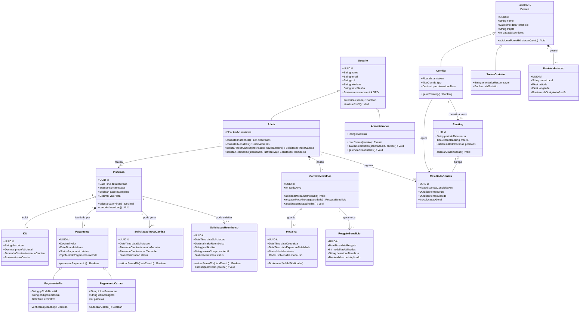
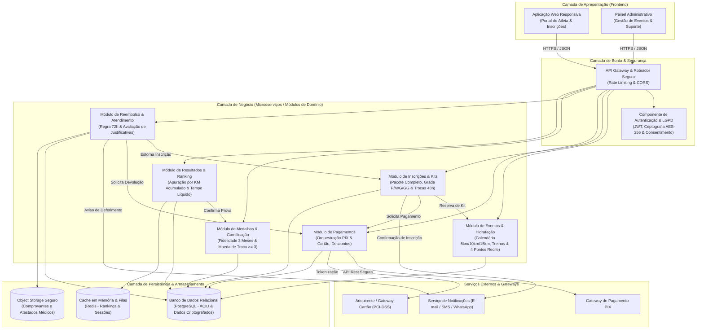

# Recife Run Club 🏃‍♂️💨

> **Projeto Acadêmico de Engenharia de Software – 2º Período - Engenharia da Computação e Sistemas de Inormação**  
> Plataforma de gestão comunitária de corridas de rua, treinos e gamificação na cidade do Recife.

---

## 1. Apresentação do Projeto e da Equipe

### 1.1 Sobre o Projeto
O **Recife Run Club** é uma solução de software concebida no âmbito da disciplina de Engenharia de Software (2º período de graduação). O objetivo é conectar apaixonados por corrida de rua na capital pernambucana, integrando esporte, saúde, turismo e valorização dos espaços públicos recifenses.

A plataforma viabiliza a inscrição em corridas oficiais, organização de treinos comunitários gratuitos, aquisição personalizada de kits, controle de hidratação em pontos históricos e modernos do Recife, sistema de ranking e uma mecânica inovadora de gamificação com medalhas de dupla função.

### 1.2 Integrantes da Equipe
O desenvolvimento do projeto é conduzido colaborativamente pela equipe:
<<<<<<< 
- **Camila Albuquerque Silva 01898272**
- **Isabela Regina Bandeira Pontes 01798209**
- **Jorge Luiz Ribeiro da Silva Dias 01898726**
- **Maria Clara Melo dos Santos  01890228**
- **Rafael Laurencio Silva 01904913**
- **Renato Santos de Melo 01876267**
- **Ruan Alves Diniz Silva 01898376**
- **Thiago Gabriel Nascimento de Lima  01894255**
=======

## 2. Identidade Visual e Paleta de Cores

A identidade cromática do **Recife Run Club** reflete alta energia, vibração urbana e modernidade esportiva, combinando com o clima tropical e a estética vibrante do Recife.

| Amostra | Nome da Cor | Hexadecimal | RGB | Aplicação no Sistema |
| :---: | :--- | :---: | :---: | :--- |
|  | **Verde Neon** | `#31EC56` | `rgb(49, 236, 86)` | Ações primárias, botões de confirmação/CTA, status de sucesso, traçados de percursos ativos e indicadores de ritmo. |
|  | **Magenta** | `#EF036C` | `rgb(239, 3, 108)` | Destaques de alta intensidade, títulos de eventos, alertas críticos, selos de corridas oficiais e elementos visuais de impacto. |
|  | **Rosa / Lilás** | `#EE72F8` | `rgb(238, 114, 248)` | Elementos secundários, badges de categorias, sistema de gamificação/medalhas, microinterações e menus de navegação. |

> **Nota de Acessibilidade (WCAG):** Os elementos de interface com as cores neon e vibrantes devem ser aplicados com contraste balanceado sobre fundos escuros (Dark Mode) ou neutros, assegurando legibilidade e conformidade com os padrões de acessibilidade digital.

---

## 3. Engenharia de Requisitos e Regras de Negócio

### 3.1 Requisitos Funcionais (RF)

| Identificador | Nome do Requisito | Descrição |
| :--- | :--- | :--- |
| **RF01** | Autenticação e Perfil de Usuário | O sistema deve permitir que atletas e administradores realizem cadastro, login seguro, redefinição de senha e gestão de perfil. |
| **RF02** | Calendário e Consulta de Eventos | O sistema deve exibir o cronograma de eventos divididos em treinos gratuitos quinzenais, corridas mensais (10km) e corridas bimestrais (5km e 15km). |
| **RF03** | Inscrição em Eventos | O atleta deve conseguir se inscrever em provas oficiais e confirmar presença em treinos gratuitos. |
| **RF04** | Seleção de Kit e Camisas | O sistema deve permitir a escolha opcional de kit e tamanho de camisa (P, M, G, GG), aplicando desconto automático no pacote completo. |
| **RF05** | Processamento de Pagamentos | O sistema deve disponibilizar pagamento via PIX (QRCode dinâmico / Copia e Cola) e Cartão de Crédito/Débito. |
| **RF06** | Troca de Tamanho de Camisa | O atleta deve conseguir solicitar a alteração do tamanho da camisa da inscrição até 48 horas antes da largada. |
| **RF07** | Cancelamento e Reembolso | O sistema deve permitir cancelamento e reembolso automático até 72h antes do evento ou abertura de chamado com justificativa após esse prazo. |
| **RF08** | Mapeamento dos Pontos de Hidratação | O sistema deve exibir nos mapas de prova os 4 pontos fixos e obrigatórios de hidratação no Recife. |
| **RF09** | Gestão de Medalhas (Modo Fidelidade) | O sistema deve registrar medalhas conquistadas e controlar sua expiração cumulativa em janela máxima de 3 meses. |
| **RF10** | Gestão de Medalhas (Modo Moeda de Troca) | O sistema deve permitir o resgate de medalhas como moeda de troca a partir do saldo mínimo de 3 medalhas ativas. |
| **RF11** | Registro de Tempos e Resultados | O sistema deve importar e armazenar tempos brutos, tempos líquidos e status de conclusão (DNF, DNS, Concluído) das provas. |
| **RF12** | Ranking Geral e por Categoria | O sistema deve gerar classificações dinâmicas baseadas na quilometragem total acumulada (KM) e no tempo líquido dos atletas. |
| **RF13** | Painel Administrativo e Suporte | A equipe de suporte/administração deve possuir painel para avaliar justificativas de reembolso e gerenciar estoques de kits. |

---

### 3.2 Requisitos Não Funcionais (RNF)

| Identificador | Categoria | Descrição Detalhada |
| :--- | :--- | :--- |
| **RNF01** | **Segurança da Informação e LGPD** | O sistema deve estar em estrita conformidade com a Lei Geral de Proteção de Dados (Lei nº 13.709/2018). Todos os dados pessoais sensíveis em repouso devem ser cifrados via AES-256 e transmitidos sob protocolo seguro HTTPS/TLS 1.3. Senhas devem utilizar algoritmos de derivação de chave com salt (Argon2id ou BCrypt). Dados financeiros de cartão não devem ser persistidos no banco da aplicação, utilizando apenas tokens providos por gateways certificados PCI-DSS. Deve haver gestão de consentimento e canal para exclusão de dados pelo titular. |
| **RNF02** | **Controle de Versão e Commits no Git** | O repositório do projeto deve seguir rigorosamente a convenção do *Conventional Commits* (ex.: `feat:`, `fix:`, `docs:`, `refactor:`, `test:`, `chore:`), garantindo rastreabilidade clara, histórico coeso e mensagens semânticas sem redundâncias ou co-autorias indevidas. |
| **RNF03** | **Desempenho e Latência** | As páginas de consulta pública e painéis de ranking devem responder em tempo inferior a 1,5 segundo sob carga regular, garantindo respostas ágeis inclusive em redes móveis 4G/5G. |
| **RNF04** | **Usabilidade e Responsividade (Mobile First)** | A interface deve ser 100% responsiva e otimizada para uso em smartphones, atendendo a corredores em movimento nos pontos de encontro da cidade. |
| **RNF05** | **Disponibilidade** | O serviço deve manter taxa mínima de disponibilidade de 99,5% (alta disponibilidade), especialmente nos dias que antecedem a abertura de inscrições e no dia das provas. |
| **RNF06** | **Integridade Transacional** | As transações de inscrição, baixa de estoque de camisas e resgate de medalhas devem ser estritamente atômicas (propriedades ACID), impedindo inconsistências e duplicações. |

---

### 3.3 Regras de Negócio (RN)

* **RN01 – Frequência e Tipos de Eventos:**
  * **Corridas Bimestrais:** Percursos de **5 km** e **15 km**, ocorrendo a cada 2 meses.
  * **Corridas Mensais:** Percurso de **10 km**, ocorrendo mensalmente.
  * **Treinos Quinzenais:** Sessões de corrida e condicionamento realizadas a cada 15 dias, com participação **100% gratuita** para toda a comunidade.

* **RN02 – Pontos Fixos Obrigatórios de Hidratação:**
  * Em todas as provas e treinos oficiais dentro do município do Recife, é mandatória a disponibilização de postos de hidratação nos seguintes 4 pontos geográficos fixos:
    1. **Marco Zero** (Bairro do Recife);
    2. **Parque das Esculturas Francisco Brennand** (Molhe de Brasília Teimosa / Bacia do Pina);
    3. **2º Jardim de Boa Viagem** (Avenida Boa Viagem);
    4. **Forte do Brum** (Praça da Comunidade Luso-Brasileira).

* **RN03 – Kits e Camisas com Desconto de Pacote:**
  * Os tamanhos oficiais de camisas disponíveis para escolha são: **P**, **M**, **G** e **GG**.
  * A aquisição do kit oficial com camisa é opcional na inscrição da prova.
  * O atleta que optar pelo **Pacote Completo** (Inscrição + Kit Oficial + Camisa) recebe automaticamente um percentual de desconto no valor consolidado da compra.

* **RN04 – Sistema de Medalhas com Dupla Função:**
  * Toda corrida oficial finalizada confere 1 medalha ao atleta. O participante pode gerenciá-la sob duas mecânicas distintas:
    * **Modo Fidelidade:** As medalhas acumuladas possuem validade temporal de até **3 meses** contados a partir da data de conquista. Nesse modo, elas elevam a categoria de fidelidade do atleta e destravam insígnias exclusivas no perfil.
    * **Modo Moeda de Troca:** A partir do acúmulo de no mínimo **3 medalhas**, o atleta pode optar por resgatá-las como moeda de troca, consumindo seu saldo para obter benefícios imediatos (como descontos progressivos em inscrições futuras, kits VIPs ou brindes de parceiros).

* **RN05 – Formas de Pagamento:**
  * O sistema aceita exclusivamente pagamentos via **PIX** (com compensação imediata via QRCode/Copia e Cola) e **Cartão de Crédito/Débito** processado via gateway seguro.

* **RN06 – Prazo para Troca de Tamanho de Camisa:**
  * O atleta pode realizar a troca do tamanho da sua camisa (P, M, G, GG) até **48 horas antes** do horário oficial de largada do evento, mediante disponibilidade do estoque do tamanho desejado. Após esse limite, a grade de produção e separação é congelada.

* **RN07 – Política de Reembolso e Cancelamento:**
  * **Reembolso Padrão:** Cancelamentos solicitados com até **72 horas de antecedência** da largada têm reembolso integral garantido automaticamente.
  * **Reembolso Excepcional:** Solicitações abertas com menos de 72 horas exigem o envio de justificativa fundamentada e comprovação documental (ex.: atestado médico) para análise e deliberação manual da equipe de suporte do clube.

* **RN08 – Critérios de Ranking:**
  * A pontuação e a posição dos atletas nas tabelas de classificação são determinadas com base em dois eixos combinados:
    1. **Quilometragem Total Acumulada (KM)** no período;
    2. **Tempo Líquido Oficial** registrado nas provas cronometradas.

---

## 4. Diagramas Estruturais UML

### 4.1 Diagrama de Classes

O diagrama de classes abaixo detalha as entidades centrais do domínio do **Recife Run Club**, seus atributos, métodos principais e relacionamentos estruturais:

#### Explicação Detalhada do Diagrama de Classes
O Diagrama de Classes modela a estrutura conceitual e orientada a objetos da aplicação:
1. **Hierarquia de Usuários (`Usuario`, `Atleta`, `Administrador`):** Centraliza os atributos comuns de autenticação, contato e auditoria de consentimento da LGPD. O `Atleta` interage com inscrições, medalhas e solicitações; o `Administrador` gerencia eventos, estoques de kits e analisa chamados excepcionais de reembolso.
2. **Especialização de Eventos (`Evento`, `Corrida`, `TreinoGratuito`):** Modela os dois tipos de eventos definidos nas regras de negócio (as corridas bimestrais de 5/15km e mensais de 10km versus os treinos quinzenais gratuitos). Todo evento contém uma composição obrigatória com a classe `PontoHidratacao`, assegurando no mínimo os 4 pontos oficiais no Recife (Marco Zero, Parque das Esculturas, 2º Jardim de Boa Viagem e Forte do Brum).
3. **Inscrição, Kit e Pagamento:** A classe `Inscricao` agrega o `Kit` opcional (com grade de camisa P, M, G, GG). Quando a inscrição reúne prova, kit e camisa, ativa a flag `pacoteCompleto` para desconto. O pagamento especializa-se em `PagamentoPix` e `PagamentoCartao`.
4. **Governança de Prazos e Suporte (`SolicitacaoTrocaCamisa` e `SolicitacaoReembolso`):** Mapeiam as regras temporais rigorosas: a troca de camisa possui o método `validarPrazo48h()` e o cancelamento possui `validarPrazo72h()`, permitindo fluxo automatizado para pedidos tempestivos ou direcionamento para análise manual com justificativa e parecer da administração.
5. **Gamificação e Medalhas (`Medalha`, `CarteiraMedalhas`, `ResgateBeneficio`):** Modela a dupla função das medalhas. Cada medalha armazena a `dataExpiracaoFidelidade` (janela de 3 meses). A classe `CarteiraMedalhas` avalia se o saldo ativo é $\ge 3$ para permitir a conversão em `ResgateBeneficio` (Modo Moeda de Troca) ou mantê-las ativas para pontuação de fidelidade.
6. **Classificação e Métricas (`ResultadoCorrida` e `Ranking`):** Consolidam os dados de quilometragem e tempo líquido para gerar os rankings periódicos e por modalidade.

---

### 4.2 Diagrama de Componentes

O Diagrama de Componentes a seguir ilustra a visão modular e arquitetural do sistema, organizada em camadas e serviços autônomos de acordo com as boas práticas de Engenharia de Software:

#### Explicação Detalhada do Diagrama de Componentes
O Diagrama de Componentes demonstra a separação de responsabilidades e desacoplamento do sistema:
1. **Camada de Apresentação (Client Layer):** Provê interfaces responsivas adaptadas para atletas em dispositivos móveis e para os operadores no painel administrativo, interagindo exclusivamente através de chamadas encriptadas HTTPS/REST.
2. **Camada de Borda & Segurança (Gateway Layer):** O `API Gateway` centraliza as políticas de entrada, mitigando ataques de força bruta e direcionando as requisições. O `Componente de Autenticação & LGPD` assegura validação de tokens JWT, garantia de autorização por perfil (RBAC) e respeito aos termos de consentimento e proteção aos dados dos participantes.
3. **Camada de Negócio (Core Business Layer):**
   - **Módulo de Eventos & Hidratação:** Responsável pelas rotas, limites de vagas e registro imutável dos 4 pontos de hidratação fixos no Recife.
   - **Módulo de Inscrições & Kits:** Controla a lógica de grade de camisas (P a GG), verificação de estoque e trava sistêmica da política de 48h para alteração de tamanho.
   - **Módulo de Pagamentos:** Implementa o padrão Factory/Strategy para processar PIX e Cartão, aplicando as deduções financeiras de pacotes completos.
   - **Módulo de Reembolso & Atendimento:** Avalia automaticamente a janela de 72h para cancelamentos imediatos e recebe os anexos comprobatórios de cancelamentos fora de prazo para julgamento humano.
   - **Módulo de Medalhas & Gamificação:** Executa tarefas agendadas para verificar a expiração de 3 meses no modo Fidelidade e gerencia a transação de queima/troca a partir de 3 medalhas.
   - **Módulo de Resultados & Ranking:** Agrega os dados de telemetria, tempos e distâncias, alimentando a classificação do clube.
4. **Camada de Persistência & Integração:** Utiliza banco relacional com propriedades ACID para garantir integridade monetária e de inscrições, cache em Redis para disponibilização de rankings com alta performance e baixa latência, e *Object Storage* protegido para os arquivos e atestados anexados ao suporte.
